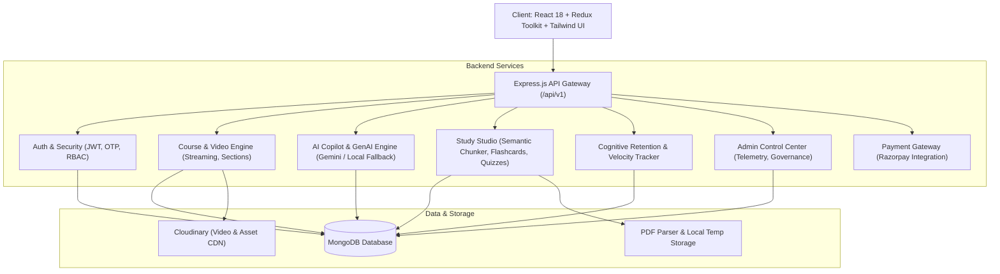

# 🎓 StudyBuddy AI — Enterprise Cognitive Learning Ecosystem

<div align="center">


**An intelligent, full-stack Education & Learning Management System (LMS) with embedded AI lecture copilots, spaced-repetition flashcards, automated quiz generation, and cognitive mastery tracking.**

[Explore Features](#-flagship-features) • [Architecture](#-architecture-overview) • [Quick Start](#-quick-start--local-setup) • [Environment Variables](#-environment-configuration) • [Deployment](#-deployment)

</div>

---

## 🌟 Highlights

- **Embedded AI Lecture Copilot**: Real-time contextual assistance beside video lectures — Socratic Q&A, chapter summaries, key concept extractors, instant quizzes, and interactive 3D flashcards.
- **AI Knowledge Studio (`/studio`)**: Upload notes/PDFs for automatic semantic chunking, 7-day mastery roadmap generation, and flashcard deck synthesis.
- **Cognitive Retention Engine**: Tracks mastery and memory decay using spaced repetition principles (Leitner system) and adaptive quiz scoring.
- **Robust Multi-Role Portals**: Complete, role-gated experiences for **Students**, **Instructors**, and **Admins**.
- **100% Zero-Cost Resilient Fallbacks**: Never breaks when an AI key expires or runs out of credits — built-in algorithmic fallbacks ensure full offline functionality.

---

## 🏗️ Architecture Overview



---

## 🚀 Flagship Features

### 1. Unified LMS & Dual-Pane Classroom
- **Synchronized Video Player**: High-definition video streaming with module checkpoints, lecture notes, and automated completion marking.
- **Split-Screen Classroom**: Course lecture controls on the left; embedded 5-tab AI Copilot docked on the right.
- **Integrated Payments**: Razorpay checkout with instant digital invoice generation and course enrollment dispatch.

### 2. Embedded AI Lecture Copilot
Directly embedded inside every course lecture:
1. **Ask AI**: Context-aware Socratic answers, conversational history, and quick starter prompts.
2. **Summarize**: Concise takeaway bullet points and high-yield definitions with one-click copy.
3. **Key Concepts**: Cards categorized by difficulty rating with explanations and code snippets.
4. **Practice Quiz**: Instant 3, 5, or 10-question multiple choice quizzes with instant feedback and score logging.
5. **Flashcards**: Instant flashcard deck generator with smooth 3D flip animation and recall difficulty indicators.

### 3. AI Knowledge Studio (`/studio`)
An independent cognitive workspace for personal notes and external study material:
- **Document Intelligence**: Upload PDF or text notes; automatic semantic extraction and full-text preview.
- **7-Day Mastery Roadmap**: Turns any topic or uploaded file into an actionable daily milestone study plan.
- **Quiz Arena**: Timed countdown challenge with difficulty selection (Beginner / Intermediate / Advanced).
- **Flashcard Lab**: Automated deck generation from documents + manual card creation, starring, and Leitner spaced repetition.

### 4. Instructor & Admin Command Centers
- **AI Course Architect**: Instantly generate structured course outlines, titles, descriptions, and learning outcomes.
- **Instructor Analytics**: Live telemetry tracking enrollments, revenue, and active student engagement.
- **Admin Governance**: System-wide platform telemetry, role administration (promote/suspend/delete), and course catalog management.

---

## 🛠️ Technology Stack

| Layer | Technologies |
| :--- | :--- |
| **Frontend** | React 18, Redux Toolkit, Tailwind CSS, React Router v6, Lucide Icons, Video-React, Swiper.js, React Hot Toast |
| **Backend** | Node.js, Express.js, Mongoose / MongoDB, JSON Web Tokens (JWT), Bcrypt, Nodemailer |
| **AI Integration** | Google Gemini API with smart deterministic zero-cost offline fallbacks |
| **Media & Docs** | Cloudinary CDN, PDF-Parse, Express-FileUpload |

---

## 📁 Repository Structure

```
studybuddyai/
├── client/                     # React 18 Frontend Application
│   ├── public/                 # Static public files & HTML shell
│   └── src/
│       ├── assets/             # Branding, images, and SVG illustrations
│       ├── components/         # Shared and modular UI components
│       │   ├── Common/         # Navbar, Footer, Modals, Rating stars
│       │   └── core/           # Auth, Dashboard, Classroom, and Copilot
│       ├── pages/              # ViewCourse, Studio, Dashboard, Catalog, Auth
│       ├── services/           # Axios API connectors (aiCopilot, studio, admin)
│       ├── slices/             # Redux state slices (auth, course, studio, cart)
│       └── utils/              # Client constants and utility helpers
├── server/                     # Node.js & Express.js Backend API
│   ├── config/                 # Database, Cloudinary, and Transporter setups
│   ├── controllers/            # Auth, Course, AI, Studio, and Admin business logic
│   ├── middleware/             # JWT auth validation & RBAC (Student/Instructor/Admin)
│   ├── models/                 # Mongoose schemas (User, Course, Quiz, Flashcard, etc.)
│   ├── routes/                 # Express API routes mounted at /api/v1/
│   ├── utils/                  # Gemini AI service, mailer, and file handlers
│   └── index.js                # Server entry point
├── scripts/                    # Automation and server runner scripts
│   └── start-server.cjs        # Unified cross-platform startup runner
├── uploads/                    # Git-ignored local file staging
├── .gitignore                  # Production-grade git exclusion rules
├── package.json                # Root orchestrator (concurrent client & server runs)
└── README.md                   # Platform documentation
```

---

## ⚡ Quick Start & Local Setup

### Prerequisites
- [Node.js](https://nodejs.org/) (v18.x or v20.x recommended)
- [MongoDB](https://www.mongodb.com/) (Local Community Server or MongoDB Atlas cluster)
- Git

### 1. Clone the Repository
```bash
git clone https://github.com/your-username/studybuddyai.git
cd studybuddyai
```

### 2. Install Dependencies
You can install both root, client, and server dependencies with a single command:
```bash
npm run install-all
```
*(Or install them individually via `cd server && npm install` and `cd ../client && npm install --legacy-peer-deps`)*

### 3. Setup Environment Variables

Create `.env` files in both **server** and **client** using the provided templates:

**Server Configuration (`server/.env`):**
```bash
cp server/.env.example server/.env
```

**Client Configuration (`client/.env`):**
```bash
cp client/.env.example client/.env
```

### 4. Run the Application
Launch both backend API and frontend client concurrently from the root directory:
```bash
npm run dev
```

- **Frontend Application**: `http://localhost:3000`
- **Backend REST API**: `http://localhost:4000/api/v1`

---

## 🔐 Environment Configuration

### Server (`server/.env`)
```env
PORT=4000
MONGODB_URL=mongodb://127.0.0.1:27017/studybuddyai
JWT_SECRET=your_super_secret_jwt_key
CLIENT_URL=http://localhost:3000

# Google Gemini AI (Optional — fallbacks provided if not set)
GEMINI_API_KEY=your_gemini_api_key

# Cloudinary CDN (Optional — for course media and video assets)
CLOUD_NAME=your_cloud_name
API_KEY=your_cloudinary_api_key
API_SECRET=your_cloudinary_api_secret
FOLDER_NAME=studybuddy

# Razorpay Payments (Optional — mock test mode supported)
RAZORPAY_KEY=your_razorpay_key_id
RAZORPAY_SECRET=your_razorpay_secret_key

# Mail Service (Optional — verification OTPs logged to console if empty)
MAIL_HOST=smtp.gmail.com
MAIL_USER=your_email@gmail.com
MAIL_PASS=your_email_app_password
```

### Client (`client/.env`)
```env
REACT_APP_BASE_URL=http://localhost:4000/api/v1
REACT_APP_RAZORPAY_KEY=your_razorpay_key_id
```

---

## 🛡️ Zero-Cost & Resilient Fallbacks

StudyBuddy AI is engineered to run seamlessly on a **\$0 budget**:
- **Offline / Zero-Quota AI**: All AI endpoints (summaries, study plans, quiz questions, concept extractors) include deterministic local heuristic generators. If an external AI provider experiences an outage, invalid key, or quota limit, students experience zero interruption.
- **Local Mail Logging**: When SMTP credentials are not configured, OTP and verification emails are cleanly routed to the server console for immediate development access.

---

## 🚢 Deployment

### Frontend (Vercel / Netlify)
1. Build the frontend:
   ```bash
   npm run build
   ```
2. Configure build settings:
   - **Root Directory**: `client`
   - **Build Command**: `npm run build`
   - **Output Directory**: `build`
   - **Environment Variables**: Add `REACT_APP_BASE_URL` pointing to your deployed backend.

### Backend (Render / Railway / VPS)
1. Deploy the `server` directory.
2. Set the start command:
   ```bash
   node index.js
   ```
3. Set your production environment variables (`MONGODB_URL`, `JWT_SECRET`, `CLIENT_URL`, etc.) in your hosting provider's dashboard.

---

## 🤝 Contributing

Contributions, issues, and feature requests are welcome!

1. Fork the project
2. Create your feature branch (`git checkout -b feature/AmazingFeature`)
3. Commit your changes (`git commit -m "feat: add AmazingFeature"`)
4. Push to the branch (`git push origin feature/AmazingFeature`)
5. Open a Pull Request

---

## 📄 License

This project is licensed under the [MIT License](LICENSE).
